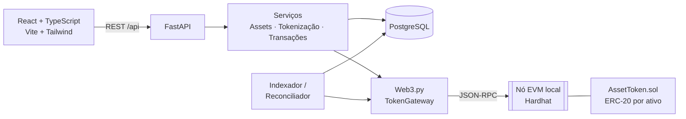
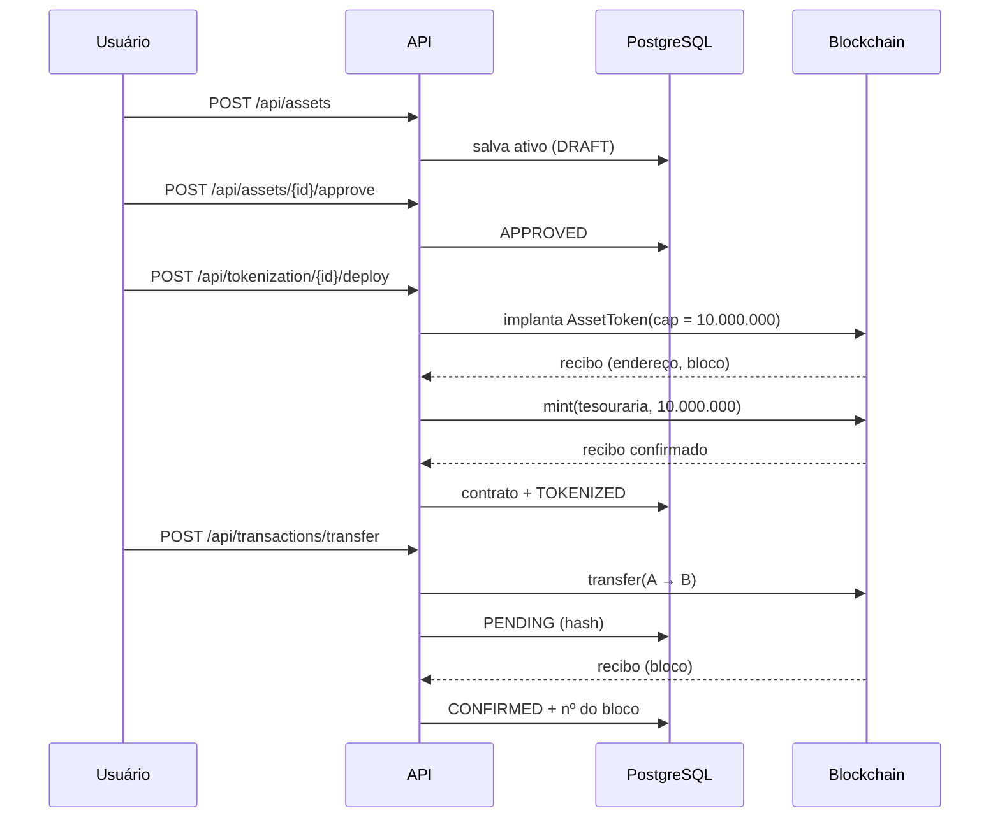

# AssetChain — Plataforma de tokenização de ativos (RWA)

> **Projeto educacional.** Todos os ativos são **fictícios**, as carteiras são **contas de teste** e as moedas **não têm valor financeiro**. Os tokens representam participações econômicas fictícias e **não constituem propriedade jurídica** sobre nenhum ativo.

AssetChain demonstra, de ponta a ponta, como um ativo do mundo real (aqui, a *Usina Solar Alpha*) pode ser representado por tokens ERC-20 em uma blockchain EVM. Nada é simulado: o contrato é implantado, os tokens são emitidos e transferidos em uma blockchain local, e a API só considera uma operação confirmada depois do recibo do bloco.


▶ **[Vídeo da demonstração (2min38s)](https://github.com/Felip3Figueredo/assetchain/releases/download/v1.0.0/assetchain-demo.mp4)**: do ambiente zerado até a transferência confirmada, o fluxo entre os nós do Besu e um validador derrubado.

## Início rápido

**Você precisa de:** Docker com Compose v2 (`docker compose version`), cerca de 4 GB de RAM livres e as portas `5173`, `8000` e `8545` livres. Não precisa instalar Node nem Python.

### 1. Subir tudo com um comando

```bash
git clone https://github.com/Felip3Figueredo/assetchain.git
cd assetchain
docker compose up --build
```

Na primeira vez o Docker baixa imagens e compila tudo (alguns minutos). Está pronto quando o log do backend mostrar `Application startup complete`. Isso sobe, já ligado entre si:

| O quê | Onde |
| --- | --- |
| **Dashboard** (use este) | http://localhost:5173 |
| API + Swagger | http://localhost:8000/docs |
| Blockchain local (JSON-RPC) | http://localhost:8545 |
| PostgreSQL | interno (não exposto) |

O backend aplica as migrações e cadastra sozinho 2 ativos fictícios (em rascunho) e 3 carteiras de teste.

### 2. Primeiro teste, em 3 minutos

1. Abra http://localhost:5173 → **Ativos** → **Usina Solar Alpha**.
2. Clique em **Aprovar para tokenização** e depois em **Implantar contrato e emitir tokens**. O backend implanta um contrato ERC-20 na blockchain e emite 10.000.000 tokens.
3. Em **Transferir tokens**, escolha *Tesouraria → Carteira B*, quantidade `100000`, e clique em **Transferir tokens**. A tela mostra o bloco e o hash depois do recibo.
4. Veja o resultado em **Carteiras** (saldos lidos da blockchain), **Transações** e **Painel**.

Prefere pelo terminal? Com a stack no ar, `./scripts/demo.sh` executa o mesmo fluxo pela API.

### 3. Variações

| Quero… | Comando |
| --- | --- |
| Já subir com a Usina Solar tokenizada e uma transferência feita | `SEED_DEMO=true docker compose up --build` |
| A rede **permissionada Hyperledger Besu** (4 validadores QBFT, aba **Rede** e fluxo entre nós) | `make up-besu` (ou `docker compose -f docker-compose.yml -f infrastructure/docker-compose.besu.yml up --build`) |
| Proteger a API com chave | `API_KEY=minha-chave docker compose up --build` (o dashboard continua funcionando) |
| Mudar senhas/portas/chaves | `cp .env.example .env` e edite |

### 4. Parar e recomeçar do zero

```bash
# Ctrl+C no terminal onde subiu (ou em outro terminal:)
docker compose down        # para, mantendo os dados
docker compose down -v     # para e APAGA banco, chave de criptografia e blockchain
```

Se subiu o Besu, use `make down` (ou o `down -v` com os dois `-f`).

### Problemas comuns

| Sintoma | O que fazer |
| --- | --- |
| `port is already allocated` | Outra aplicação usa 5173, 8000 ou 8545. Pare-a ou mude a porta em `infrastructure/docker-compose.yml`. |
| Painel mostra **Rede offline** | A blockchain ainda está iniciando (no Besu leva ~30 s para os nós se conectarem). Espere e recarregue. |
| Reiniciei só a blockchain e os dados sumiram | Esperado: a rede de desenvolvimento não persiste estado. O backend detecta, limpa os dados órfãos e refaz o seed ao reiniciar. |
| `permission denied` no Docker | Rode com um usuário no grupo `docker` ou use `sudo`. |
| Quero ver os logs | `docker compose logs -f backend` |

Mais detalhes sobre a rede permissionada em [docs/besu.md](docs/besu.md).

## O problema que a tokenização busca resolver

Ativos como usinas, imóveis ou recebíveis são caros, indivisíveis na prática e difíceis de negociar em frações. A tokenização representa participações econômicas como tokens: frações pequenas, histórico auditável de movimentações e regras (como limite de emissão) aplicadas por código. Aqui o foco é técnico: como emitir, transferir e auditar essas participações com segurança.

## Como a blockchain funciona neste projeto

1. Uma rede EVM local (Hardhat) produz blocos e executa contratos Solidity.
2. O backend Python (Web3.py) assina transações localmente e as envia por JSON-RPC.
3. Cada ativo tokenizado ganha **seu próprio contrato** `AssetToken` (ERC-20 + teto de emissão + dono).
4. O backend espera o **recibo** (`status == 1`) antes de marcar uma transação como `CONFIRMED`.
5. A **blockchain é a fonte de verdade** dos saldos. O PostgreSQL guarda metadados, referências e eventos indexados; um reconciliador compara os dois.

## Arquitetura



Camadas do backend (`backend/app`): `api` (rotas) → `services` (regras de negócio) → `repositories` (acesso a dados) / `blockchain` (Web3.py), com `domain` (estados e unidades), `models`, `schemas` e `core` (config, logs, segurança, erros). Mais detalhes em [docs/architecture.md](docs/architecture.md).

## Fluxo de tokenização



Detalhes em [docs/tokenization-flow.md](docs/tokenization-flow.md).

## Tecnologias

| Camada | Tecnologias |
| --- | --- |
| Blockchain | Solidity 0.8.24, OpenZeppelin 5 (ERC20, ERC20Capped, Ownable), Hardhat, JSON-RPC |
| Backend | Python 3.12+, FastAPI, Pydantic v2, SQLAlchemy 2, Alembic, Web3.py, structlog, Pytest |
| Banco | PostgreSQL 16 |
| Frontend | React 18, TypeScript, Vite, Tailwind CSS, Recharts, TanStack Query, Vitest |
| Infra | Docker, Docker Compose |

## Demonstração, vídeo e screenshots

- `./scripts/demo.sh` percorre o fluxo pela API: aprova o ativo, implanta o contrato, emite 10 milhões de tokens, transfere 100 mil da carteira A (tesouraria) para a B e mostra saldos, hash e bloco.
- Screenshots em `docs/screenshots/` (painel, ativo, carteiras, transações, rede e fluxo entre nós).
- Vídeo: com a stack no ar, `cd scripts/demo-video && npm i && npx playwright-core install ffmpeg && node record.mjs` grava a interface com Playwright (`NODE_FAILURE=0` pula a parte de derrubar um validador no Besu).

## Como executar os testes

```bash
# Contratos (Hardhat)
cd blockchain && npm ci && npx hardhat test

# Backend (sobe um nó Hardhat local automaticamente; `make test-besu` roda contra o Besu)
cd backend && python -m venv .venv && .venv/bin/pip install -r requirements.txt
cd ../blockchain && npx hardhat compile && npx ts-node scripts/export-artifact.ts && cd ../backend
.venv/bin/pytest

# Frontend
cd frontend && npm ci && npm test
```

Os testes de integração e o teste do fluxo completo usam uma blockchain local real (`npx hardhat node`), sem mocks de chain.

## Exemplos de chamadas da API

```bash
API=http://localhost:8000

# Cadastrar e aprovar
curl -X POST $API/api/assets -H 'Content-Type: application/json' -d '{
  "asset_code":"ASSET-003","name":"Parque Eólico Gama","category":"Energia renovável",
  "estimated_value_brl":5000000,"token_supply":5000000,"token_price_brl":1.0}'
curl -X POST $API/api/assets/1/approve

# Implantar o contrato e emitir (idempotente)
curl -X POST $API/api/tokenization/1/deploy -H 'Idempotency-Key: deploy-asset-1'

# Transferir 100.000 tokens
curl -X POST $API/api/transactions/transfer -H 'Content-Type: application/json' \
  -H 'Idempotency-Key: transfer-001' -d '{
  "asset_id":1,"from_address":"0x...A","to_address":"0x...B","amount":"100000"}'

# Consultas
curl $API/api/wallets/0x...B/balances
curl $API/api/blockchain/transactions/0x...hash
curl $API/api/blockchain/blocks/latest
```

Resposta típica de uma transferência:

```json
{
  "tx_hash": "0x9f1c…",
  "asset_code": "ASSET-001",
  "kind": "TRANSFER",
  "amount": "100000",
  "status": "CONFIRMED",
  "block_number": 5
}
```

Referência completa em [docs/api.md](docs/api.md).

## Segurança e limites do ambiente experimental

- Apenas contas e chaves **de teste** (as contas públicas do Hardhat). Não use fundos ou carteiras reais.
- Chaves privadas das carteiras criadas pela plataforma ficam **criptografadas (Fernet)** no banco. A chave mestra é **gerada por instalação** no primeiro start e guardada no volume `appdata` (arquivo `0600`); você também pode fornecer a sua em `FERNET_KEY`. Em produção isso seria um KMS/HSM.
- **Autenticação opcional:** defina `API_KEY` e toda rota `/api` (exceto `/api/health`) exige o cabeçalho `X-API-Key`. O nginx do dashboard injeta a chave, então a porta 8000 fica protegida contra acesso direto. Não há login por usuário nem papéis.
- A tesouraria usa a chave pública nº 0 do Hardhat, conhecida por qualquer pessoa: **a rede é descartável**.
- Validação de entrada (endereços, quantidades), tratamento de erros RPC (503/409/504), emissão limitada pelo `cap` do contrato.
- **Idempotência** (`Idempotency-Key`) em deploy e transferência: a chave é reservada antes de enviar à chain, fica amarrada à operação e aos dados, e timeouts de recibo são retomados pelo hash em vez de repetir a transação.
- Nonces são serializados por conta; criar carteira só persiste depois de financiá-la.
- Nenhum dado pessoal ou documento é gravado na blockchain.
- Não há KYC, custódia, conformidade regulatória nem marketplace.

Mais em [docs/blockchain.md](docs/blockchain.md).

## Limitações

- A blockchain local do Hardhat é efêmera (sem persistência) e tem um único nó. Se só ela reiniciar, no ambiente Docker o backend detecta os contratos órfãos, limpa os dados da aplicação e refaz o seed (`AUTO_RESET_ON_CHAIN_MISMATCH=true`, só para desenvolvimento; desligado, ele apenas avisa no log).
- O indexador roda sob demanda (ao consultar detentores ou após transferências), não como processo contínuo.
- Sem login por usuário, sem reorgs (a rede local tem finalidade imediata), sem suporte a múltiplas redes simultâneas.
- No Besu o permissionamento é por **nó**, não por conta (veja [docs/besu.md](docs/besu.md)).
- Os valores em R$ são apenas metadados informativos; não há preço de mercado.

## Ethereum, ETH, contratos, ERC-20 e tipos de rede

| Conceito | O que é |
| --- | --- |
| **Ethereum** | Plataforma de blockchain programável: uma rede de nós que mantém um estado compartilhado e executa código (EVM). |
| **Ether (ETH)** | Criptomoeda nativa do Ethereum, usada para pagar taxas (gas). Aqui há ETH de teste, sem valor. |
| **Smart contract** | Programa implantado na blockchain, com endereço e estado próprios, executado por todos os nós. Aqui, escrito em Solidity. |
| **Token ERC-20** | Padrão de contrato para tokens fungíveis (saldo, `transfer`, `approve`, eventos `Transfer`). Cada ativo daqui tem seu ERC-20. |
| **Blockchain pública** | Qualquer pessoa participa e valida (Ethereum mainnet). Aberta e resistente à censura, porém pública e com taxas reais. |
| **Blockchain permissionada** | Só participantes autorizados operam nós ou transacionam (ex.: Hyperledger Besu em modo privado). Comum em uso corporativo; é a Fase 2 deste projeto (veja abaixo). |

## Fase 2 — Hyperledger Besu

A mesma aplicação roda sobre uma rede **permissionada** com 4 validadores QBFT e nós autorizados por allowlist, apenas trocando a configuração de rede:

```bash
make up-besu       # sobe PostgreSQL + 4 nós Besu + backend + frontend
./scripts/demo.sh  # o mesmo cenário, agora em chain 1337
make test-besu     # a suíte do backend contra o Besu
```

A aba **Rede** do dashboard mostra os validadores, o quórum e quem propôs cada bloco; clicando no hash de uma transação você vê o **fluxo entre os nós** (quem recebeu, quem propôs o bloco e se cada nó tem o mesmo bloco). Dá para derrubar um validador e ver a rede continuar. Detalhes em [docs/besu.md](docs/besu.md).

## Roteiro

- **Fase 1:** stack completa com Hardhat local.
- **Fase 2:** rede permissionada Hyperledger Besu (QBFT, 4 validadores).

## Licença

MIT — veja [LICENSE](LICENSE).
