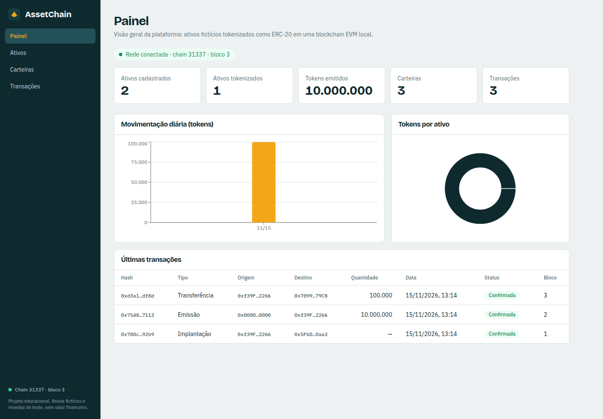
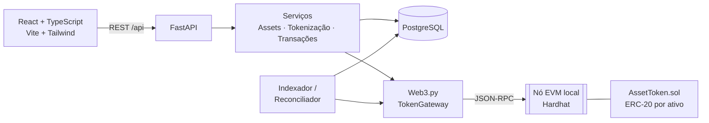
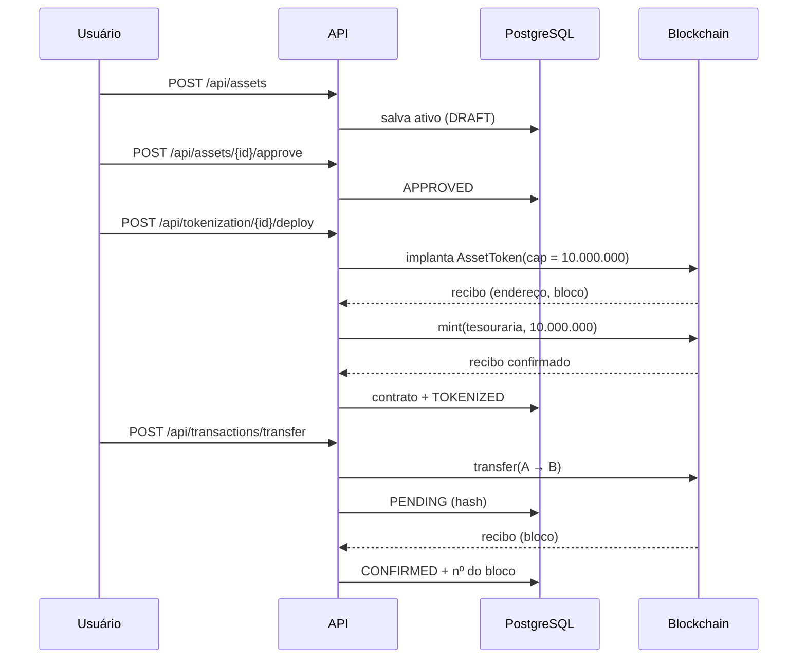

# AssetChain — Plataforma de tokenização de ativos (RWA)

> **Projeto educacional.** Todos os ativos são **fictícios**, as carteiras são **contas de teste** e as moedas **não têm valor financeiro**. Os tokens representam participações econômicas fictícias e **não constituem propriedade jurídica** sobre nenhum ativo.

AssetChain demonstra, de ponta a ponta, como um ativo do mundo real (aqui, a *Usina Solar Alpha*) pode ser representado por tokens ERC-20 em uma blockchain EVM. Nada é simulado: o contrato é implantado, os tokens são emitidos e transferidos em uma blockchain local, e a API só considera uma operação confirmada depois do recibo do bloco.



## O problema que a tokenização busca resolver

Ativos como usinas, imóveis ou recebíveis são caros, indivisíveis na prática e difíceis de negociar em frações. A tokenização representa participações econômicas como tokens: frações pequenas, histórico auditável de movimentações e regras (como limite de emissão) aplicadas por código. Aqui o foco é técnico: como emitir, transferir e auditar essas participações com segurança.

## Como a blockchain funciona neste projeto

1. Uma rede EVM local (Hardhat) produz blocos e executa contratos Solidity.
2. O backend Python (Web3.py) assina transações localmente e as envia por JSON-RPC.
3. Cada ativo tokenizado ganha **seu próprio contrato** `AssetToken` (ERC-20 + teto de emissão + dono).
4. O backend espera o **recibo** (`status == 1`) antes de marcar uma transação como `CONFIRMED`.
5. A **blockchain é a fonte de verdade** dos saldos. O PostgreSQL guarda metadados, referências e eventos indexados; um reconciliador compara os dois.

## Arquitetura



Camadas do backend (`backend/app`): `api` (rotas) → `services` (regras de negócio) → `repositories` (acesso a dados) / `blockchain` (Web3.py), com `domain` (estados e unidades), `models`, `schemas` e `core` (config, logs, segurança, erros). Mais detalhes em [docs/architecture.md](docs/architecture.md).

## Fluxo de tokenização



Detalhes em [docs/tokenization-flow.md](docs/tokenization-flow.md).

## Tecnologias

| Camada | Tecnologias |
| --- | --- |
| Blockchain | Solidity 0.8.24, OpenZeppelin 5 (ERC20, ERC20Capped, Ownable), Hardhat, JSON-RPC |
| Backend | Python 3.12+, FastAPI, Pydantic v2, SQLAlchemy 2, Alembic, Web3.py, structlog, Pytest |
| Banco | PostgreSQL 16 |
| Frontend | React 18, TypeScript, Vite, Tailwind CSS, Recharts, TanStack Query, Vitest |
| Infra | Docker, Docker Compose |

## Como executar localmente

Requisitos: Docker e Docker Compose v2.

```bash
cp .env.example .env   # opcional: os padrões já funcionam
docker compose up --build
```

| Serviço | URL |
| --- | --- |
| Dashboard | http://localhost:5173 |
| API (Swagger) | http://localhost:8000/docs |
| JSON-RPC da blockchain | http://localhost:8545 |

Na primeira subida o backend aplica as migrações e roda o seed (2 ativos em rascunho e 3 carteiras de teste). Para subir já com a Usina Solar Alpha tokenizada e uma transferência de exemplo, use `SEED_DEMO=true docker compose up --build`.

> A blockchain de desenvolvimento **não persiste** estado. Se reiniciar só o container `chain`, o PostgreSQL ficará apontando para contratos que não existem mais (o backend avisa no log). Use `docker compose down -v` para resetar tudo.

### Demonstração passo a passo

```bash
./scripts/demo.sh
```

O script percorre o fluxo completo pela API: aprova o ativo, implanta o contrato, emite 10 milhões de tokens, transfere 100 mil da carteira A (tesouraria) para a B, consulta os saldos, o hash e o bloco da transação. Depois abra o dashboard.

Para gravar um vídeo curto: rode `docker compose up --build`, abra o dashboard, execute `./scripts/demo.sh` em um terminal ao lado e mostre (1) o ativo, (2) o contrato implantado, (3) a transferência entre carteiras e (4) o hash e o bloco em *Transações*.

### Screenshots

Com a stack no ar e `SEED_DEMO=true`, capture o painel (`/`), o detalhe do ativo (`/assets/1`), as carteiras (`/wallets`) e as transações (`/transactions`) e salve em `docs/screenshots/`.

## Como executar os testes

```bash
# Contratos (Hardhat)
cd blockchain && npm ci && npx hardhat test

# Backend (sobe um nó Hardhat local automaticamente)
cd backend && python -m venv .venv && .venv/bin/pip install -r requirements.txt
cd ../blockchain && npx hardhat compile && npx ts-node scripts/export-artifact.ts && cd ../backend
.venv/bin/pytest

# Frontend
cd frontend && npm ci && npm test
```

Os testes de integração e o teste do fluxo completo usam uma blockchain local real (`npx hardhat node`), sem mocks de chain.

## Exemplos de chamadas da API

```bash
API=http://localhost:8000

# Cadastrar e aprovar
curl -X POST $API/api/assets -H 'Content-Type: application/json' -d '{
  "asset_code":"ASSET-003","name":"Parque Eólico Gama","category":"Energia renovável",
  "estimated_value_brl":5000000,"token_supply":5000000,"token_price_brl":1.0}'
curl -X POST $API/api/assets/1/approve

# Implantar o contrato e emitir (idempotente)
curl -X POST $API/api/tokenization/1/deploy -H 'Idempotency-Key: deploy-asset-1'

# Transferir 100.000 tokens
curl -X POST $API/api/transactions/transfer -H 'Content-Type: application/json' \
  -H 'Idempotency-Key: transfer-001' -d '{
  "asset_id":1,"from_address":"0x...A","to_address":"0x...B","amount":"100000"}'

# Consultas
curl $API/api/wallets/0x...B/balances
curl $API/api/blockchain/transactions/0x...hash
curl $API/api/blockchain/blocks/latest
```

Resposta típica de uma transferência:

```json
{
  "tx_hash": "0x9f1c…",
  "asset_code": "ASSET-001",
  "kind": "TRANSFER",
  "amount": "100000",
  "status": "CONFIRMED",
  "block_number": 5
}
```

Referência completa em [docs/api.md](docs/api.md).

## Segurança e limites do ambiente experimental

- Apenas contas e chaves **de teste** (as contas públicas do Hardhat). Não use fundos ou carteiras reais.
- Chaves privadas das carteiras criadas pela plataforma ficam **criptografadas (Fernet)** no banco; a chave mestra vem do ambiente. Em produção isso seria um KMS/HSM.
- A tesouraria usa a chave pública nº 0 do Hardhat, conhecida por qualquer pessoa: **a rede é descartável**.
- A API não tem autenticação nem autorização por usuário. Foi omitida de propósito por escopo; seria o primeiro item de uma versão real.
- Validação de entrada (endereços, quantidades), tratamento de erros RPC (503/409), emissão limitada pelo `cap` do contrato e **idempotência** (`Idempotency-Key`) em deploy e transferência.
- Nenhum dado pessoal ou documento é gravado na blockchain.
- Não há KYC, custódia, conformidade regulatória nem marketplace.

Mais em [docs/blockchain.md](docs/blockchain.md).

## Limitações

- A blockchain local do Hardhat é efêmera (sem persistência) e tem um único nó.
- O indexador roda sob demanda (ao consultar detentores ou após transferências), não como processo contínuo.
- Sem autenticação, sem reorgs (a rede local tem finalidade imediata), sem suporte a múltiplas redes simultâneas.
- Os valores em R$ são apenas metadados informativos; não há preço de mercado.

## Ethereum, ETH, contratos, ERC-20 e tipos de rede

| Conceito | O que é |
| --- | --- |
| **Ethereum** | Plataforma de blockchain programável: uma rede de nós que mantém um estado compartilhado e executa código (EVM). |
| **Ether (ETH)** | Criptomoeda nativa do Ethereum, usada para pagar taxas (gas). Aqui há ETH de teste, sem valor. |
| **Smart contract** | Programa implantado na blockchain, com endereço e estado próprios, executado por todos os nós. Aqui, escrito em Solidity. |
| **Token ERC-20** | Padrão de contrato para tokens fungíveis (saldo, `transfer`, `approve`, eventos `Transfer`). Cada ativo daqui tem seu ERC-20. |
| **Blockchain pública** | Qualquer pessoa participa e valida (Ethereum mainnet). Aberta e resistente à censura, porém pública e com taxas reais. |
| **Blockchain permissionada** | Só participantes autorizados operam nós ou transacionam (ex.: Hyperledger Besu em modo privado). Comum em uso corporativo; é a evolução planejada deste projeto. |

## Roteiro

- **Fase 1 (esta):** stack completa com Hardhat local.
- **Fase 2:** rodar a mesma aplicação sobre uma rede permissionada Hyperledger Besu.

## Licença

MIT — veja [LICENSE](LICENSE).
